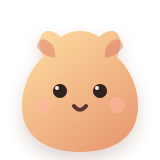
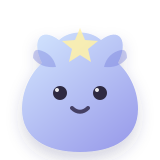

# Phase 3 — Dual Pets and Comic Chat Bubbles

This phase builds on Phase 2 and keeps the same Socket.IO server contract:

- `pet_move` sends `{ x, y }` as percentages.
- `send_msg` sends `{ text, lang }`.
- `pet_action` sends interaction states such as `{ action: "poke", pet: "pet_me" }`.

## What changed

- The decorative CSS pets were replaced by swappable `` sprites:
  - `assets/pet-me.svg`
  - `assets/pet-partner.svg`
- `pet_me` is draggable inside the Room Box pet stage.
- On pointer release, `pet_me` emits `pet_move` with percentage coordinates.
- Incoming `pet_move` updates `pet_partner` with a smooth CSS transition.
- Sending a message shows a comic bubble above `pet_me` for 5 seconds and emits `send_msg`.
- Incoming `send_msg` shows a matching bubble above `pet_partner` for 5 seconds.
- Bubbles use `textContent`, `white-space: pre-wrap`, `overflow-wrap: anywhere`, and `line-break: auto` to handle Traditional Chinese and English safely.

## Swap the placeholders

Replace either SVG with your own GIF, PNG, WebP, or sprite sheet path in `index.html`:

```html


```

For GIFs, keep the `.pet-sprite` class and update only the `src` value.

## Test with two clients

Terminal 1:

```bash
cd server
npm install
npm start
```

Terminal 2:

```bash
npm install
npm start
```

Open the same app on another computer or another project copy. In settings, use the same server URL and pair code.
